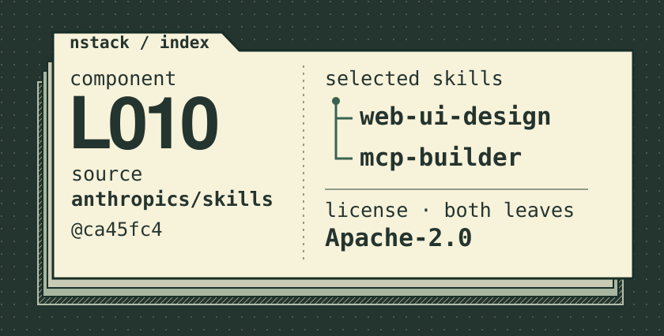

# Stack+

**Select 01 once. Give your lead the outcome you want.** You can ask for a decision, a working application, a research result or an artifact someone else will use. Your lead works out what the result requires and which of your available skills, tools, plugins, MCP servers or specialists can contribute. You can change direction in the same conversation.

| In Codex | In OpenCode | To end it |
|---|---|---|
| Select `$01` | Select `@01` | Say “turn 01 off” |

Work in the project that owns the result. Describe what someone needs to be able to do with it, give the lead the inputs you have, and mention any real constraints. You can leave the implementation open. A fresh chat starts independently.

## What changes when the goal changes

Consider a shift planner who asks for the cheapest crew that can finish before opening. The lead initially recommends Lark at $100 and files the morning dispatch. Then operations changes the requirement. The public must be able to use the equipment by 09:32. Mechanical completion alone no longer settles the booking.

In the tested case, the old project method had been withdrawn. The lead found a new method named `linen-sheet` through a receiver-acceptance technique in its supporting files. It ran the calculator and matched observations to crew bids. The desk could reproduce all three ready times. Lark was ready at 09:50, Wren at 09:30 and Ibis at 09:15. Wren at $125 became the cheapest projected choice. The original dispatch stayed filed.

One more fact changed what the desk could do. Operations required signed observations. A calculation could price Wren without authorizing the booking. The first draft's wording blurred that distinction. A fresh reader caught it. The revised dispatch held the booking and kept Wren as the priced contingency. The signed control supported release and the unsigned control called for a hold. The public regression lets you reproduce both decisions and change one observation after signing. [Run the acceptance case](evals/01/acceptance-handoff/README.md)

A spelling correction needs a much shorter workflow. In the timetable control, 01 changed one Saturday destination, checked the saved file and left the two similar neighboring entries alone. It used no specialist. An open-ended task earns more discovery and independent review when those contributions can change the result.

## Where the expertise comes from

- **Start with the actual project.** The lead can use its native methods, existing code, connected services and authorized tools. Project overrides and disables govern which capabilities it can use.
- **Discover expertise by the work it does.** The 219 selected methods can live in versioned bundles outside the default prompt. Search can reach a technique in supporting files, even when the bundle name gives little away. New methods can enter discovery without changing 01. [Selections, scopes and staging](docs/stackplus-selections.md)
- **Follow evidence across disciplines.** An engineer can calculate a result, a reader can test whether the proposed action follows from it, and the lead can revise the handoff. Elephant–Goldfish makes that independent check reproducible when the stakes justify it. It also works when 01 is off. [Project review](docs/STACKPLUS-REVIEW.md)
- **Keep durable decisions small.** Working state and test artifacts stay with the project. An authorized private knowledge writer can retain a lasting decision and link back to its evidence. [Knowledge integration](integrations/knowledge-continuity/README.md)

## Install on a Mac

With Git and Python 3.11 or newer, open the public checkout and try a selection lookup.

```sh
git clone https://github.com/nazeeh111/Stack-Plus.git
cd Stack-Plus
./stack+ selections review-pcba --json
```

To add 01 to a new shared skill root, use `python3 native_setup.py install --only 01`. For an existing collection, follow the disposable rehearsal and preservation steps first. The installer prints its rollback path. Skills that depend on an account, application or device need that resource in the project where they run. [Install and verify](docs/ONBOARDING.md) · [OpenCode](docs/OPENCODE.md) · [Restore](docs/RESTORE.md)

<details>
<summary>Registry reference, optional installation profiles and historical compatibility</summary>



[Rehearse a Mac setup](docs/ONBOARDING.md) · [Inspect the recorded outputs](docs/presentation/README.md) · [Restore a setup](docs/RESTORE.md)

## Explore before installing

From a checkout with Python 3.11 or newer, try a frontend design task. The
commands below read the registry with an unused state path and leave it absent.

```sh
(
  export NSTACK_STATE="$PWD/.nstack-demo-state"
  [ ! -e "$NSTACK_STATE" ] && [ ! -L "$NSTACK_STATE" ] || exit 1
  python3 nstack.py search web-ui-design --brief
  python3 nstack.py show L010
  python3 nstack.py route L010
)
```

**What to look for in the output**

| Command | What the record tells you |
| --- | --- |
| [`search`](docs/presentation/search.json) | `web-ui-design` and `mcp-builder` belong to component `L010`. |
| [`show`](docs/presentation/show.json) | The two selected source paths share a pinned revision. The upstream document skill has different rights and is excluded. |
| [`route`](docs/presentation/route.json) | For frontend work, check mobile layout, keyboard use and reduced motion in the actual interface. The runtime still needs separate verification. |

If you know the task but not the skill name, try
`python3 nstack.py search keyboard layout accessibility --brief --limit 1`.
The [keyboard and mobile-layout walkthrough](docs/presentation/ui-audit.md)
connects that result to the exact audit source, its license and a one-skill rehearsal.

## Use it in a project

- **Set up a host.** Rehearse a single skill in a temporary home, then choose your permanent collection. [Mac onboarding](docs/ONBOARDING.md) · [OpenCode adapter](docs/OPENCODE.md)
- **Follow a worked example.** A synthetic clap becomes an editable decay plot and an independently checked measurement. [Room-decay example](examples/clap/README.md)
- **Inspect a change.** Read how selection, pinned source, backups and rollback work. [Source fidelity](docs/SOURCE_FIDELITY.md) · [Transaction design](docs/TRANSACTIONS.md)

<details>
<summary><strong>Operator reference</strong> · CLI bootstrap, runtime commands, recovery and platform support</summary>

## Install on a Mac

For a new Codex installation, use the
[host-aware installation prompt](docs/ONBOARDING.md). OpenCode has a
[separate adapter](docs/OPENCODE.md). The retained
[Claude Code adapter documentation](docs/CLAUDE.md) describes its compatibility
source; that host is not part of the current Mac workflow.
[Craft Anything](docs/CRAFT_ANYTHING.md) is an optional local software
analysis addition; its static tooling and rebuild workflows have distinct checks.


Requirements: Git, Python 3.11 or later, and a compatible Codex or OpenCode host.
Run the installer with that supported Python explicitly if `python3` resolves
to an older system version. The installed `nstack` launcher binds the installing
interpreter, so later PATH changes do not select another Python. Keep that
interpreter available; reinstall with a new run ID after moving or replacing it.
The installer leaves system Python and PATH unchanged.
When Node is available during installation, the launcher also records its
directory as a command-local fallback for Node-based tools. A Node already on
the current PATH keeps precedence. This does not install Node or alter shell
configuration.
The pinned CLI bootstrap currently supports native Apple Silicon macOS only.
The independently managed desktop app is preserved. No API key, purchase or
provider signup is part of installation. `uv` is needed only for the selected
Python runtime recipes; Node/npm and browser downloads are needed only for the
selected JavaScript recipes. The FFmpeg recipe uses the existing Apple compiler
and make.

Use [onboarding](docs/ONBOARDING.md) to inspect the complete native skill
profile, rehearse it in an isolated home, and install it for Codex or OpenCode.
The legacy CLI cutover is separate. To stage the toolkit and pinned Apple
Silicon CLI without applying changes to the host profile:

```sh
python3 install.py install --stage-only --bootstrap-cli
```

If you explicitly intend the older CLI cutover, review its staged result and
retain recovery files before applying it. The `--retire-personal` option moves
the previous user-managed collection into private recovery storage. Skip this
cutover for an existing compatible setup or when you only want native skills.

```sh
python3 install.py install --bootstrap-cli --retire-personal --run-id cutover
"$HOME/.local/bin/nstack" doctor
```

## Discovery and recovery design

Search and native installation share the selected-name policy. One selection
reads one manifest snapshot, so a registry replacement cannot mix two parsed
generations within that operation. The next selection reads the current
manifest again; there is no persistent cache to invalidate.

Recovery records the destination directory's identity as well as the installed
entry. If that directory is moved and replaced, repair and rollback refuse the
replacement before writing. Restoring the original directory permits recovery;
unrelated dirty bytes remain preserved. [Transaction behavior and platform
limits](docs/TRANSACTIONS.md) includes legacy journals and interrupted operations.

The regression checks use disposable directories and synthetic installations.
They do not establish that a separately installed version has these changes,
or that every optional runtime is ready for a real task.

## Optional additions

Choose optional additions in that single `native_setup.py` command rather than
running successive replacements: `--academic-research`, `--ecc`, `--unslop`,
`--maps-scraper`, `--untangle-codebase`, `--raea`, `--adaptive-routing`,
`--llm-council`, `--roast-room`, `--council-of-high-intelligence`,
`--skillspector`, `--rea`, `--craft-anything`,
`--creative-reframing`, `--playwright-mcp`, `--agent-orchestration`,
`--dream-loop`, `--fpga`, `--cirq`, `--formal-verification`, `--research-engines`,
`--agent-desktop` and `--game-systems-review`.
Academic sources are fetched privately under their noncommercial license.
[Source fidelity](docs/SOURCE_FIDELITY.md) explains upstream methods, native ports and private source packs.
When replacing a collection, include all additions you intend to retain.

The base install command retires the complete old user-managed skill collection into
private recovery storage, preserving built-ins. It merges only owned config
keys and preserves unrelated settings and current model/effort choices. It
does not read credential stores, move projects or conversations, manage hosted
account connections, or replace the desktop application. Inventory and back up
any separately managed hooks, profiles, plugins and jobs before retiring them.
An explicit private retirement plan supports snapshotted Codex profiles, hooks,
skill-lock files and already-unloaded Mac LaunchAgents. It rejects changed
targets and leaves other applications and jobs alone.

Private state defaults to `~/Library/Application Support/nstack/`, outside
skill discovery. Immutable code releases, source cache, reviewed builds,
runtime locks, private backups and restart-safe ownership journals live there.
`NSTACK_STATE` can select a separate private deployment for testing. Add
`$HOME/.local/bin` to your normal PATH if it is absent. To replace an existing
CLI entry elsewhere, pass its exact absolute path with `--cli-path`.

## OpenCode

An optional [OpenCode V2 adapter](docs/OPENCODE.md) reuses the same skills,
user instructions and canonical vault. It preserves the selected model and
credentials, disables background warming, and adds only the existing documentation
and semantic connections. Host-native accounts and automatic memories remain separate.

For the actual Codex agent engine inside an OpenCode project terminal, use the
optional [native harness launcher](docs/OPENCODE.md#actual-codex-harness).
[DeepSeek Harness, Superagent and OpenHarness](docs/HARNESSES.md) have distinct
roles; adding a model provider is not a harness replacement.

The optional [untangle-codebase](https://github.com/caldoai/skills/tree/f3cf47774975a7d9fca45730babf4ff7ad765ada/skills/untangle-codebase)
skill is shared by both hosts. Invoke it explicitly with `$untangle-codebase` in
Codex or select it with `@untangle-codebase` in OpenCode. It stays out of automatic
skill selection because it requests a substantial refactor. Its pinned MIT source
and license are bundled; no additional runtime, service or provider is needed.

## First unfamiliar task

Open an ordinary project and ask for the finished result. No project-init step
is required. Codex discovers the installed skill summaries and reads the relevant
complete SKILL.md and support when needed. The global collection contains only
170 selected on-demand leaves, plus explicit additions if enabled. The academic suite adds five skills and keeps
its CC BY-NC source separate from this MIT repository.
RAEA local GPU rendering is available with the optional native flag `--raea`.
Its pinned runtime stays separate from this MIT toolkit and runs offline without
upstream hooks, model downloads or provider connections. See [RAEA](docs/RAEA.md).

[REA](docs/REA.md) optionally adds shipped-software analysis with its own pinned
private runtime. It remains separate from Craft Anything and RAEA.

For visual automation, durable background jobs, AI application graphs, optional
tracing and codebase graphs, see [On-demand workflows](docs/WORKFLOWS.md).
These recipes do not start services or create accounts during skill installation.

Heavy dependencies are separate and remain on demand. Search the full installed
`native-skill-index.json` when the native summary list is truncated.

For one explicit entry to adaptive selection across the session, add
`--adaptive-routing` to the native install command and invoke `$01` once.
It keeps ordinary work direct and applies relevant specialists as the task
changes. [Behavior, testing and limits](docs/ADAPTIVE_ROUTING.md).

`--agent-orchestration` adds the reusable native lead/specialist method for
dynamic delegation, user-defined worker tiers or verified inheritance, checked
handoffs, integration and fresh-context review. The chosen lead and effort stay
selected; unset Y/Z tiers supply no model defaults. It complements 01's capability selection and installs no
second agent framework. The [host comparison](addons/agent-orchestration/references/hosts.md)
distinguishes native coordination from applications that need Agents SDK or
LangGraph. [Context and cost efficiency](integrations/context-efficiency/README.md)
records TokenEconomizer's source-tested limits and the bounded ideas worth using
without activating unverified hooks or tool pruning.

`--game-systems-review` adds document-based game balance and GDD interaction
review adapted from Donchitos' Game Studios methods. It does not install the
whole studio or claim engine/playtest validation. `--agent-desktop` retains
Vercel Labs' desktop method and platform guides. Installation of that method
does not install or admit its CLI; verify native admission and startup effects
before any command, including help/status. Read the respective native bindings.

Optional [LLM Council](docs/COUNCIL.md) adds independent alternatives, blinded
critique and reversed-order checks. It uses available native workflows; its
offline helper makes no model requests. Multi-provider use needs its own
connection, data scope and budget. No simulator or extra service is started.

For a security-sensitive change, the [selected defensive methods](profiles/stackplus/defensive/) cover static review, remediation and independent checks with conventional project tests. Stage the one that fits the change.

Optional [SkillSpector](docs/SKILLSPECTOR.md) audits agent instructions and their
bundled source with the pinned NVIDIA static scanner and source-aware review.
The shared skill adds no cloud provider or always-on scanner.

```sh
nstack search room clap decay
nstack show P318
python3 native_setup.py list
```

Candidate IDs remain provenance keys in the catalog and commands. Installed skill
names have no candidate-number prefix. “Personal” in Codex is its category for
user-installed skills, including this new collection.

`native_setup.py` privately backs up the actual root and instructions, rehearses
restoration, publishes recovery before changing the profile, installs only the
selected entries, and preserves complete support bundles outside discovery.
It updates only the owned nstack instruction block. Repeating the same install
leaves target bytes and the journal unchanged. It also repairs deletion of its
exact owned root link without changing the original rollback baseline.

The older project publisher remains available for deliberately temporary,
project-scoped experiments. It is optional. Do not expose the same leaf through
both mechanisms. Source fetches use full Git commits and verified blobs; trial,
substitute, consultation and excluded entries are rejected by generic activation.

For native tool connections, the knowledge vault, exact runtime revisions and
what was actually checked, see [Everyday setup](docs/EVERYDAY_SETUP.md). The
portable installer does not copy an author's private account, vault, plugins or
runtime environments onto another Mac.

## On-demand routes

`nstack route ID` returns the exact source, prerequisites, activation, check and
retirement sequence. All 198 on-demand components have a route: 46 use reviewed
selected leaves, 93 have isolated runtime recipes (94 operations), and 59 use
native build or official application procedures. Some components also retain
supporting leaves. The 28 trials and seven substitutes remain conditional;
generic publication, workspace creation and runtime commissioning reject them.
Their per-ID target verifiers must be implemented and pass before admission.
The nine consult records never become standalone installs.

Python source recipes build the exact selected source into an isolated wheel
with separate hash-locked build dependencies and runtime dependencies. Go
recipes use a checksummed private toolchain and the exact selected source.
Node workspaces use their native package manager, check packed local dependency
closure, and install only the native target packages into the named project.
No dormant route provisions an account, GPU, model, service or application.
A recipe is available for use; its actual target remains untested until checked.

Native source builds can start with `nstack workspace ID /absolute/project`.
This creates a private editable checkout and output prefix, outside discovery.
Repeat use requires unchanged source and Git bytes. `--fresh` retains an edited
attempt before preparing another. `nstack retire-workspace ID /absolute/project`
retains all bytes, including unexpected files, and removes only active ownership.
Follow the route's explicit working directory, lock procedure and environment.

## Local runtime operations

Examples with concrete commission, invocation, check and removal commands:

| Component | Operation | Scope |
|---|---|---|
| P053 | `cli` | ast-grep 0.51.1 structural search/refactor |
| P061 | `test` | Playwright Test 1.65.0, matched Chromium and Firefox |
| P318 | `rt60` | Exact reviewed pure-Python room-decay estimator; hash-locked environment |
| P230 | `media` | Minimum local-only FFmpeg/ffprobe build from the reviewed source commit |
| P190 | `cli` | Exact-source Gitleaks with private, redacted scanning reports |
| P144 | `python` | Exact-source Optuna in a locked isolated Python environment |
| P198 | `ux` | Selected local UX guidance data and stdlib lookup helper |
| P355 | `posting` | Local posting-text decoder and hidden-instruction guard |

```sh
nstack commission P318 rt60
nstack check P318 rt60
nstack run P318 rt60 -- clap.wav result.json
nstack commission P230 media
nstack check P230 media
nstack run P230 media -- ffprobe -v error -show_streams -of json output.mkv
nstack remove-runtime P230 media
```

Commissioning resolves only the registered operation. It never silently selects
a newer product or enables a whole collection. Existing locks are checked on
repeat use. Removal moves the exact owned environment into recovery storage,
including unexpected local additions, and removes its active receipt. It does
not recursively delete those bytes. Other runtime/platform/provider lanes keep
their prerequisites and target checks explicit in the catalog; a missing
adapter or unmet condition is a blocked operation, not a passing installation.

The original [synthetic clap example](examples/clap/README.md) produces editable
SVG, PDF, PNG and CSV, checks the known decay with an independent stdlib
comparator, and rejects a stale handoff before regeneration. No recording,
private data, model or API is required.

`nstack inventory /absolute/project` reads a fresh native CLI's skill and local
MCP metadata through its supported app-server protocol. `--binary /absolute/codex`
can inspect a separately managed backend. It discards raw configuration and
environment values. It does not establish normal desktop relaunch, hosted plugin
enablement or successful provider access. Hosted optional plugins must be retired
through supported native controls while preserving built-ins and account access.

Add `--plugins` to request fresh native plugin installation/enabled metadata and
marketplace error counts. An error or an unobserved remote catalog cannot prove
a plugin was removed. Installation, enabled state and actual tool use are separate
checks. Keep personal plugin choices in private deployment records; do not copy
account identifiers or preferences into the public registry. An explicitly retained
official plugin can coexist with the on-demand catalog without a duplicate local
skill collection. Its installation grants no new sending, spending or data access.
The native effective-config response is held transiently to extract server names
and local enablement flags. Configuration layers and credential files are not
requested; raw configuration is discarded.

## Correctable knowledge and handoffs

Keep one canonical project record, source attribution and current input hashes.
From inside the owning project:

```sh
nstack knowledge set /absolute/project fixture-level --claim '30 dB' --source evidence.txt
nstack knowledge read /absolute/project fixture-level
nstack knowledge delete /absolute/project fixture-level --expected-generation 1
```

Retrieval checks current project scope and actual source bytes. A correction
supersedes the prior generation; deletion leaves a tombstone. Updates and
deletions must pass `--expected-generation N` using the generation returned by
`read`. Competing writers serialize; a stale generation is refused without
changing the accepted record. Creation expects generation 0. Commit durable
records through the project's authorized Git workflow. Reject stale derived
results at handoff and regenerate affected artifacts. Native automatic memory
remains separate and can skip externally sourced sessions; do not claim a
canonical-record check proves automatic-memory generation. Retrieval indexes
and memory services are conditional additions, not extra permanent authorities.

## Roll back from Terminal

```sh
"$HOME/Library/Application Support/nstack/rollback.sh"
```

The helper works independently of Codex and follows the recorded release chain
back to the pre-cutover profile. It restores only the recorded changes.
Owned TOML edits are inverted while preserving later unrelated edits. A later
conflicting edit to the same owned setting stops rollback for reconciliation.
New projects, knowledge and conversations are preserved. An explicit job plan
restores definitions in their original unloaded state; the installer never
stops or starts a loaded service. macOS may assign a new `com.apple.provenance`
tag to a copied file; nstack leaves that system tag alone while checking bytes,
ACLs, ownership, flags, modes and other extended attributes.

Keep the private backup after success. Reinstalling the same release/run is
idempotent; changing release code uses a new recorded run so earlier rollback
helpers and originals remain available.

## Redistribution

Original toolkit code is MIT. Third-party terms remain independent; see
[THIRD_PARTY_NOTICES.md](THIRD_PARTY_NOTICES.md). This repository publishes
portable metadata, original adapters and patch mechanisms. It contains no raw
research ledger, private deployment, account binding, credential, personal
vault, conversation export or proprietary plugin implementation. Restricted
services and assets must use their official access and rights checks.

## Verification and supported scope

Run the portable tests with the command above. `python3 tests/check_recovery.py check --output /absolute/private/capture`
uses a loopback capture receiver and synthetic identities to test lost
acknowledgements, restart and exactly one business effect. It never sends mail.
The registry contract test checks full component/path coverage and permissions;
private deployment receipts and the supplied raw-ledger coverage checker stay
outside this public tree.

The pinned bootstrap supports Apple Silicon macOS. The normal CLI and independent
desktop backend have separate loaders; a backend inventory is not a desktop UI
check. Trial, proprietary, hardware-specific, provider and large model lanes are
conditional on their own rights, platform, resources and output checks. These
sources do not imply that every target runtime has been installed or tested.

</details>

</details>
